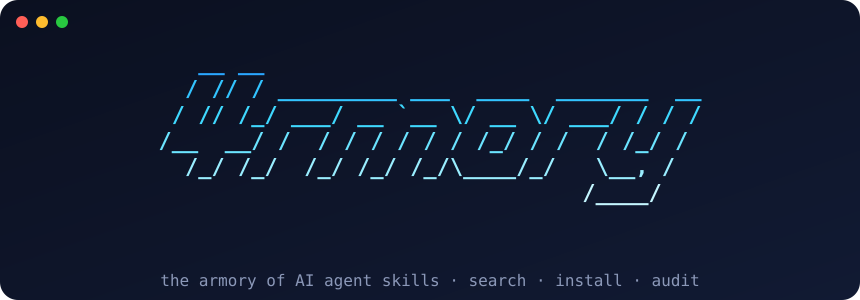

<div align="center">




### The armory of AI agent skills

**Search, install and safety-scan the best skills and tools for Claude Code, Codex, OpenCode and other agents — from one small Bash command.**

[](#requirements)
[](catalog/armory.tsv)
[](#safety-first)
[](LICENSE)

[Quick start](#quick-start) · [Commands](#commands) · [Categories](#categories) · [Safety](#safety-first) · [Contributing](#add-your-own) · [Security](SECURITY.md)

</div>

---

## Why 4rmory?

There are thousands of agent skills on GitHub. Some are great, many are noise, and a few are dangerous.
4rmory is a hand-picked catalog sorted into clear categories, plus a CLI that:

- 🔎 **finds** the right skill in seconds (`4rmory search video script`)
- 📦 **installs** it into your agent's skills folder with one command
- 🛡️ **scans it first** with NVIDIA SkillSpector, Cisco Skill Scanner and a built-in check — high-risk installs are blocked
- ✏️ **lets you curate** your own list: add, edit and remove entries

## Quick start

```bash
git clone https://github.com/Z1esco/4rmory.git
cd 4rmory && ./install.sh
4rmory setup
```

`setup` asks which agent you use and which areas you work in, then scans and installs the matching skills.
Run `4rmory` with no arguments any time for a simple menu.

### Requirements

| Needed | Optional (better experience) |
|---|---|
| `bash` 3.2+, `git`, `awk` | `fzf` (arrow-key menus), `figlet` (live banner) |
| | [`skillspector`](https://github.com/NVIDIA/SkillSpector) and [`skill-scanner`](https://github.com/cisco-ai-defense/skill-scanner) (deep security scans) |

```bash
pipx install git+https://github.com/NVIDIA/skillspector.git
pipx install cisco-ai-skill-scanner
4rmory doctor
```

## Commands

<div align="center">

| Find | Install | Manage | Safety |
|:---|:---|:---|:---|
| `search <words>` | `setup` | `add` | `audit <id>` |
| `list [category]` | `install <id>` | `edit <id>` | `audit --installed` |
| `categories` | `uninstall <id>` | `remove <id>` | `doctor` |
| `info <id>` | `installed` · `update` | `export` | |

</div>

```bash
4rmory search humanizer                 # search everything
4rmory search marketing -k skill        # only installable skills
4rmory list design                      # one category
4rmory info superpowers                 # details, install and audit status
4rmory install superpowers --agent claude
4rmory audit --installed                # re-scan what you have
```

Install targets: `claude` → `~/.claude/skills`, `codex` → `~/.codex/skills`,
`opencode` → `~/.config/opencode/skills`, `agents` → `~/.agents/skills`.
Downloads live in `~/.local/share/4rmory` and skills are linked, never copied over your own files.

**Kinds:** 🟢 `skill` (installs into your agent) · 🔵 `tool` (an app or library — follow its README) · 🟣 `mcp` · 🟡 `collection` (a list to discover more).

## Categories

<div align="center">

| | Category | What's inside |
|:-:|:--|:--|
| ⭐ | `essentials` | Start here: must-have agent skills |
| 🎨 | `design` | UI/UX, web design and anti-slop |
| 🧠 | `engineering` | Code understanding and software engineering |
| ✍️ | `copywriting` | Copywriting, marketing and brand voice |
| 📱 | `social` | Captions and social media |
| ▶️ | `youtube` | YouTube and creator workflows |
| 🎬 | `motion` | Motion design, animation and game visuals |
| 🖼️ | `image` | Image generation and visual AI |
| 🎧 | `audio` | Audio, voice and speech-to-text |
| 📖 | `fiction` | Novels, fiction and screenwriting |
| 🪶 | `editing` | Humanizer, editing and natural writing |
| 🔬 | `research` | Research, OSINT and knowledge work |
| 🛡️ | `security` | Cybersecurity and secure AI agents |
| ⚙️ | `automation` | Automation, agents and MCP |
| 📄 | `docs` | Documents, reports and knowledge bases |
| 📊 | `data` | Data, analytics and machine learning |
| 🚀 | `product` | Product, SaaS and growth |

</div>

The full, readable list is in [CATALOG.md](CATALOG.md) (generated with `4rmory export`).

## Safety first

Every install is scanned **before** anything is linked into your agent:

1. **[NVIDIA SkillSpector](https://github.com/NVIDIA/SkillSpector)** — malicious patterns, prompt injection, data exfiltration, supply-chain risk.
2. **[Cisco Skill Scanner](https://github.com/cisco-ai-defense/skill-scanner)** — static, behavioural and YARA analysis.
3. **Built-in check** — fast grep for pipe-to-shell, reverse shells, credential paths, webhooks and miners.

Verdicts: ✅ `clean` · ⚠️ `review` · ⛔ `high risk` (install blocked unless you pass `--force` after reading the report).
Results are logged in [`catalog/audit.tsv`](catalog/audit.tsv) and summarised in [AUDIT.md](AUDIT.md).
Scanners find known risk patterns; they don't prove a skill is safe. Read what you install.

## Add your own

```bash
4rmory add                                    # guided
4rmory add --name "My Skill" --url https://github.com/me/my-skill \
           -c engineering -k skill -d "Plain sentence: what it helps with."
4rmory edit my-skill description "Better wording"
4rmory remove my-skill
4rmory audit my-skill
```

The catalog is one tab-separated file, [`catalog/armory.tsv`](catalog/armory.tsv):
`id · category · kind · name · description · url`. See [CONTRIBUTING.md](CONTRIBUTING.md).

## Project layout

```
4rmory            entry point (loads lib/*)
lib/core.sh       paths, agents, validation
lib/theme.sh      colours (respects NO_COLOR)
lib/ui.sh         banner, prompts, menus
lib/catalog.sh    search, list, add, edit, remove, export
lib/install.sh    clone, link, uninstall, update, setup
lib/audit.sh      SkillSpector + Cisco + built-in scans
catalog/          armory.tsv (the list) and audit.tsv (scan log)
tools/            import_md.py: rebuild the catalog from a Markdown directory
```

<div align="center">

---

Made for people who'd rather build than browse. · [MIT License](LICENSE)

</div>
